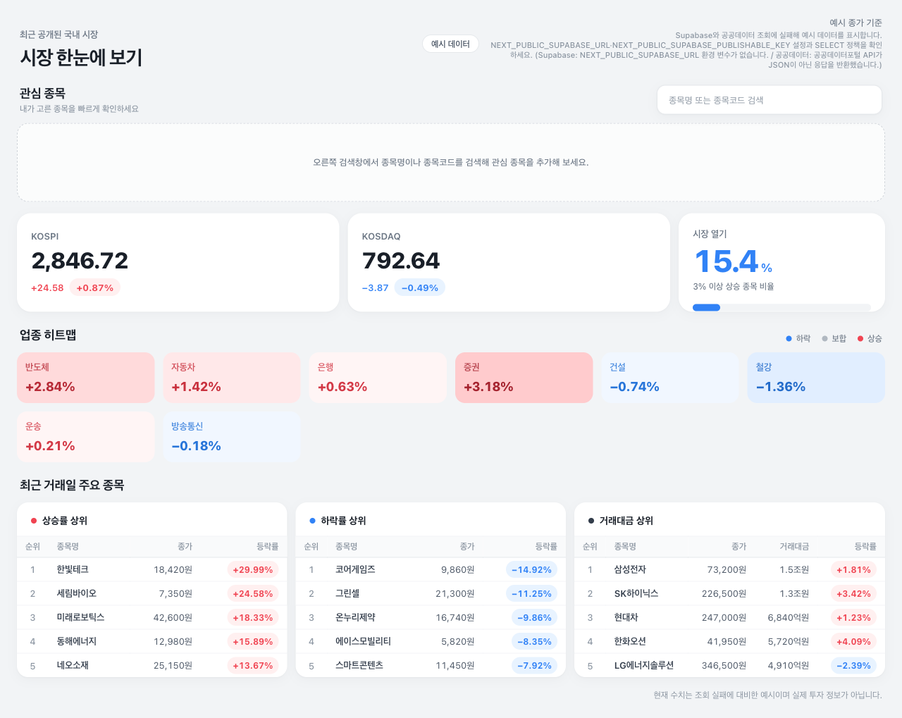
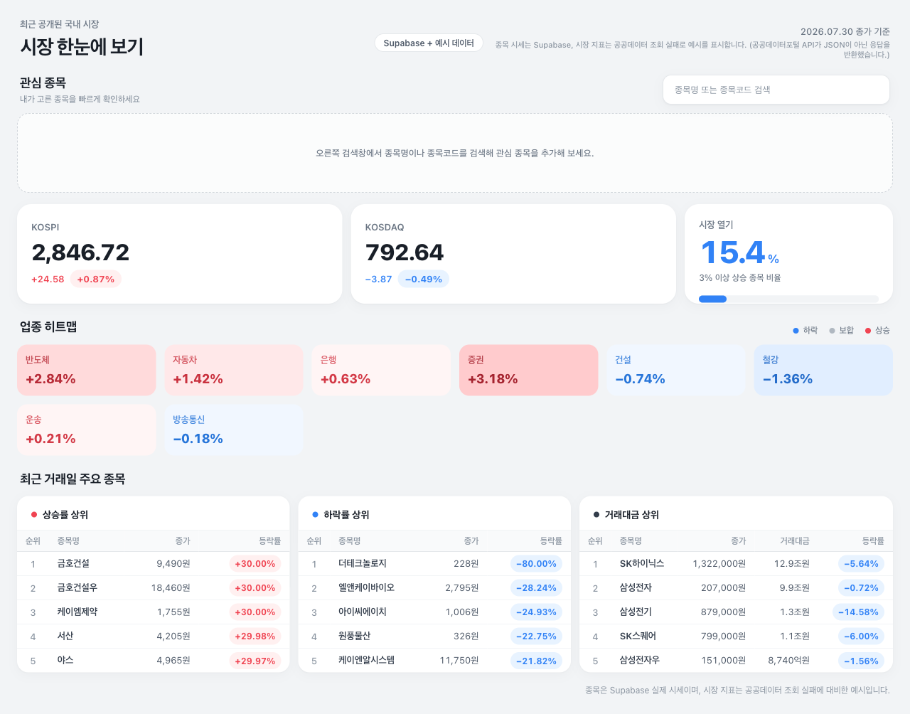

# 16장 배포 검증 기록 — codex-vercel-example

이 문서는 `ch16` 폴더의 코드를 Vercel 연동 저장소
[`forest-lim-dev/codex-vercel-example`](https://github.com/forest-lim-dev/codex-vercel-example)에
동기화해 실제로 배포하고, 배포된 화면을 읽기 전용으로 검증한 기록이다.
16장 본문의 §16.4~16.6 흐름(첫 배포 → 예시 데이터 증상 → 진단 → 환경변수 입력 →
재배포 → 확인)을 실제 배포로 재현했다.

검증 일시: 2026-08-05 (KST)
생성 환경: Claude Code, Vercel CLI 55.0.0, Playwright MCP

## 전체: WARNING

| 영역 | 상태 | 확인한 근거 | 다음 행동 |
| --- | --- | --- | --- |
| 배포 상태 | PASS | 최신 Production 배포 `gaednavw1`이 Ready이고 배포 커밋이 `main` HEAD `5efa42b`와 일치. 대표 주소 alias가 이 배포를 가리킴 | 없음 |
| 배포 화면 | WARNING | 대표 주소 HTTP 200, 제목·기준일·출처 일관. 단 시장 지표 영역이 예시 데이터로 남음(배지가 출처를 구분 표시) | 지역 제약 — 아래 "남은 제약" 참고 |
| 런타임 로그 | PASS | 관찰 구간 내 `GET /` 3건 전부 200, 5xx 0건 | 없음 |
| 환경변수 계약 | PASS | 코드 요구 이름 3개 = `.env.sample` 3개 = Vercel Production 등록 3개, 세 집합이 완전 일치 | 없음 |
| Git 비밀 검사 | PASS | 차단 0건. 검토 후보 3건은 실제 키 지문과 대조해 전부 오탐으로 확인 | 없음 |

- 공유 대상 SHA: `5efa42b4e412dde602eaa676c2dd015670c0e4f2`
- 배포 SHA: `5efa42b4e412dde602eaa676c2dd015670c0e4f2` (일치)
- 대표 주소: https://codex-vercel-example.vercel.app
- 로그 관찰 구간: 배포 시각 2026-08-05 01:20:58 KST부터 검증 시각까지

## 동기화 내용

`ch16` 폴더를 저장소 상태로 그대로 미러했다(`rsync -a --delete`,
`.git`·`node_modules`·`.next`·`.idea`·`.vercel`·`.env.local` 제외). 결과적으로
작업 트리가 `ch16`과 바이트 단위로 같다.

| 구분 | 내용 |
| --- | --- |
| 삭제 | `app/api/watchlist/`, `app/Watchlist.js`, `app/page.module.css`, `lib/priceStore.js`, `lib/watchlistStore.js`, `lib/supabaseServer.js`, `lib/exampleMarketData.js`, `API_CHECK.md` |
| 삭제 | `.codex/skills/verify-market-dashboard/` — 구버전 계약(`/api/watchlist`·`SUPABASE_ANON_KEY`·`daily_stock_prices`) 전제라 현재 코드와 불일치 |
| 추가 | `components/` 6개, `data/marketSnapshot.js`, `test/` 3개, `AGENTS.md`, `eslint.config.mjs`, `jsconfig.json`, `lib/supabaseMarketData.js`, `lib/market.js` |
| 교체 | `app/page.js`, `app/layout.js`, `app/globals.css`, `lib/marketData.js`, `lib/dataGoKr.js`, `package.json`, `package-lock.json`, `README.md`, `PROMPTS.md`, `.gitignore` |

`.idea/`는 `ch16/.gitignore`에 없다(책 저장소는 루트 `.gitignore`가 처리). 미러를
깨지 않으려고 저장소의 `.git/info/exclude`에만 넣었다. 커밋되지 않는 로컬 설정이다.

푸시 전 로컬 검증: `npm ci` 후 `npm test`(`node --test && next build`) 통과 —
테스트 17/17, 프로덕션 빌드 성공.

## 배포 아크

| 단계 | 커밋 | 배포 | 결과 |
| --- | --- | --- | --- |
| 1차 (before) | `38652e5` | `fr9ioe2mu` | Ready, 화면은 전면 예시 데이터 |
| 환경변수 교체 | — | — | 구버전 이름 제거, ch16 계약 이름 등록 |
| 2차 (after) | `5efa42b` | `gaednavw1` | Ready, 종목 시세가 Supabase 실데이터로 전환 |

두 배포 모두 `git push origin main`이 유발했다. Vercel 프로젝트에 GitHub 연동이
이미 붙어 있어(`codex-vercel-example-git-main-codex-dev00.vercel.app` alias) 별도
연결 작업은 없었다.

2차 배포에 빈 커밋을 쓴 이유가 있다. 루트 페이지가 `export const revalidate = 3600`
으로 **빌드 타임에 프리렌더**되므로(`○ (Static)`), 환경변수만 바꾸면 기존 빌드
산출물이 그대로 서빙되어 화면이 바뀌지 않는다. 새 빌드를 반드시 유발해야 한다.

## §16.4~16.5 — 첫 배포의 예시 데이터 증상



Vercel에 등록돼 있던 환경변수 이름이 구세대(`SUPABASE_URL`·`SUPABASE_ANON_KEY`)라
ch16 코드가 요구하는 이름과 어긋났다. 화면 상태는 다음과 같았다.

- 배지: `예시 데이터` (회색 `mock-badge`)
- 기준일: `예시 종가 기준`
- 종목명: `한빛테크`·`세림바이오` 등 `data/marketSnapshot.js`의 예시 값
- 안내문: 두 실패를 각각 짚음

> Supabase와 공공데이터 조회에 실패해 예시 데이터를 표시합니다.
> `NEXT_PUBLIC_SUPABASE_URL`·`NEXT_PUBLIC_SUPABASE_PUBLISHABLE_KEY` 설정과 SELECT
> 정책을 확인하세요. (Supabase: `NEXT_PUBLIC_SUPABASE_URL` 환경 변수가 없습니다. /
> 공공데이터: 공공데이터포털 API가 JSON이 아닌 응답을 반환했습니다.)

여기서 짚어 둘 점이 있다. **배포는 Ready였고 런타임 로그에 5xx가 하나도 없었다.**
`GET /` 요청은 전부 200으로 응답했다. 앱이 오류로 죽는 대신 예시 데이터로 우아하게
강등되도록 설계돼 있기 때문이다. 그래서 이 증상의 진단은 오류 로그가 아니라
화면의 안내문과 빌드 로그에서 나온다. 배포 상태만 보고 정상이라고 판단하면 놓친다.

빌드 로그에는 공공데이터포털 요청의 실패가 원문으로 남아 있었다.

```
Failed to set fetch cache URL {
  href: 'https://apis.data.go.kr/1160100/service/GetStockSecuritiesInfoService/getStockPriceInfo?serviceKey=[REDACTED]&...',
  ...
} [Error [TimeoutError]: The operation was aborted due to timeout]
데이터 조회 실패: 공공데이터포털 API가 JSON이 아닌 응답을 반환했습니다.
```

인증키는 Vercel이 `[REDACTED]`로 가려서 기록한다.

## §16.6 — 환경변수 입력과 재배포

Vercel Production 환경변수를 ch16 계약으로 교체했다. 값은 화면·로그에 출력하지
않고 stdin으로만 `vercel env add`에 전달했다.

| 작업 | 이름 |
| --- | --- |
| 제거 | `SUPABASE_URL`, `SUPABASE_ANON_KEY` |
| 등록 | `NEXT_PUBLIC_SUPABASE_URL`, `NEXT_PUBLIC_SUPABASE_PUBLISHABLE_KEY` |
| 재설정 | `DATA_GO_KR_SERVICE_KEY` |

`DATA_GO_KR_SERVICE_KEY`를 굳이 다시 넣은 이유는, Vercel CLI 55의 `vercel env pull`이
암호화된 값을 전부 빈 문자열로 돌려주어 기존 등록값을 읽거나 대조할 수 없었기
때문이다. 값을 확인할 수 없으면 추정하지 말고 아는 값으로 확정하는 편이 낫다.



재배포 후 화면 상태다.

- 배지: `Supabase + 예시 데이터`
- 기준일: `2026.07.30 종가 기준` — Supabase `daily_quotes`의 실제 최신 `trade_date`
- 종목명: `SK하이닉스`(1,322,000원)·`삼성전자`(207,000원) 등 실제 종목
- `NEXT_PUBLIC_SUPABASE_URL 환경 변수가 없습니다` 오류 소멸

환경변수가 제대로 반영됐다는 직접 증거다. 로컬에서 미리 확인해 둔 Supabase 응답
(기준일 `2026-07-30`, 2,764행)과 화면의 기준일이 일치한다.

## 남은 제약 — 공공데이터포털 API의 지역 차이

after 화면에서도 지수 카드·시장 열기·업종 히트맵은 예시 데이터로 남았다. 두 캡처를
나란히 보면 분명하다. KOSPI `2,846.72`, KOSDAQ `792.64`, 시장 열기 `15.4%`,
반도체 `+2.84%` — **before와 after의 숫자가 한 자리도 다르지 않다.** 같은 예시
데이터를 계속 보여 주고 있다는 뜻이다.

원인은 인증키가 아니라 위치다. 같은 키로 로컬(국내)에서 실행하면 `source`가
`supabase+public-api`로 나오고 지수·업종까지 실데이터로 채워진다. 반면 Vercel의
빌드·실행 리전은 `iad1`(미국 동부)이고, 여기서 `apis.data.go.kr` 요청은
`TimeoutError`로 끊긴다.

| 실행 위치 | `snapshot.source` | 배지 | 지수·업종 |
| --- | --- | --- | --- |
| 로컬 (국내) | `supabase+public-api` | `Supabase + 공공데이터` | 실데이터 |
| Vercel (`iad1`) | `supabase+example` | `Supabase + 예시 데이터` | 예시 데이터 |

앱은 이 상황을 실패로 처리하지 않는다. 실데이터가 있는 영역과 예시로 채운 영역을
배지와 안내문으로 구분해 표시한다. 배포 화면을 WARNING으로 판정한 근거가 이것이며,
버그가 아니라 외부 API의 지역 제약을 기록한 것이다. 16장 `PROMPTS.md`에 적힌
실측 결과와도 같다.

## Git 비밀 검사

`ch17/.agents/skills/verify-market-dashboard/scripts/scan_git_secrets.py`를 이
저장소에 실행했다(스크립트는 저장소에 커밋하지 않았다). 결과는 차단 0건, 검토
후보 3건이었다. 세 건을 모두 실제 인증키의 SHA-256 지문과 대조했고, 도달 가능한
모든 커밋에서 **실제 키와 일치하는 값은 0건**이었다.

| 위치 | 매치 | 실제 내용 | 판정 |
| --- | --- | --- | --- |
| `lib/dataGoKr.js` | `serviceKey = ...` | `process.env[SERVICE_KEY_ENV_NAME]?.trim()` — 환경변수에서 읽는 코드 | 오탐 |
| `lib/dataGoKr.js` | `searchParams.set("serviceKey", ...)` | 함수 호출로 값을 넣는 코드 | 오탐 |
| `.codex/hooks/protect-auth-keys.test.cjs` | `LOCAL_SECRET`·`API_KEY` | 훅 자체의 테스트 픽스처(`local-secret-value-...`) | 오탐 |

정규식이 "비밀처럼 생긴 이름 뒤의 긴 값"을 잡기 때문에, 환경변수를 **올바르게**
읽는 코드도 후보로 걸린다. 검토 후보는 사람이 판정할 목록이지 그 자체가 유출은
아니다.

## 재현 방법

```bash
# 1. 저장소를 받아 로컬 검증
git clone git@github.com:forest-lim-dev/codex-vercel-example.git
cd codex-vercel-example
cp .env.sample .env      # 세 값을 채운다
npm ci && npm test

# 2. Vercel 환경변수 확인 (이름만)
vercel env ls

# 3. 배포된 화면 확인
curl -s https://codex-vercel-example.vercel.app/ \
  | grep -oE '<span class="(mock|source)-badge">[^<]*</span>|<time>[^<]*</time>'
```
